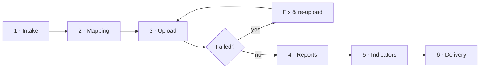

# Bank Statement Processing: Process Design & Automation (Business Analysis Project)

I designed an end-to-end process for handling batches of bank statement PDFs: from understanding the requirements,
through preparing and processing the data and analysing failures, to delivering a clear results workbook.
Each step is supported by a small script, so the process runs the same way every time.

## The problem

Bank statement PDFs arrive in batches, in different shapes (single files, folders per customer, nested folders)
and sometimes with issues (password-protected, unreadable, wrong format). Processing them by hand is slow and error-prone, and the results are hard to share.

## My role

- **Designed the end-to-end process:** the six steps, their order, inputs and outputs, and where people and scripts each take over
- **Gathered requirements:** what needs to be evaluated and what data to expect
- **Reviewed and mapped the data:** decided which statements belong to which customer
- **Analysed failures:** found the root cause of every failed statement, fixed what could be fixed, re-processed it, and raised system gaps so support could be added
- **Coordinated the review** of results before they were finalised
- **Prepared the deliverable:** the final results workbook and reports for sharing

## Process I designed



| Step | What happens |
|---|---|
| **1. Intake** | Capture the requirements for a batch (what to analyse, what data is expected) in a simple form |
| **2. Mapping** | Review the data carefully (who each statement belongs to, which bank, passwords) and map every file to its customer. Some files came with the password inside the file name, separated by `_` (e.g. `xyz_sbi_1234.pdf` → `1234`), so for those the password is extracted from the name |
| **3. Upload** | Create a session per customer (gives a session ID), then upload each PDF into it with the session ID, the PDF, its password (only if protected) and the bank name (optional, only if known). Failed files are investigated, fixed and uploaded again |
| **4. Reports** | Excel reports per account: a first round for review, a final round after corrections |
| **5. Indicators** | Collect the key indicators for each account |
| **6. Delivery** | One results workbook for sharing, plus the final reports |

## Example: one customer, many statements

XYZ has two bank accounts (SBI and Baroda) and shares 3 statements for each, 6 PDFs in total.

1. **Mapping:** after reviewing the data, all 6 files are mapped to one customer, `xyz`.
2. **Upload:** one session is created for XYZ and the 6 PDFs are uploaded into it one by one, without a bank name.
3. **Processing:** the system detects the bank, the account holder (identity) and the transactions from each PDF.
4. **Reports:** the session contains 2 accounts, so 2 Excel reports come back, one per account:

```
xyz__sbi__<account_id>.xlsx       ← 3 SBI statements combined
xyz__baroda__<account_id>.xlsx    ← 3 Baroda statements combined
```

## Deliverable

One results workbook from the system (summary, status of every file, indicators and reference sheets),
shared together with one Excel report per account.

## Failure analysis

Every failed statement was investigated to find the root cause, and handled according to it:

| Root cause | Action |
|---|---|
| Password missing or wrong | Correct password provided, statement re-uploaded |
| Invalid or damaged PDF | Asked for a valid copy of the statement |
| Scanned (image) PDF | Asked for the original digital statement |
| Not a bank statement | Excluded and reported |
| Format not yet supported by the system | Raised so support could be added to the system, then re-processed |

## Business rules & decisions

- **Passwords:** a password-protected PDF is processed only if its password is provided; for unprotected PDFs the password is left blank.
- **Success rule:** a statement counts as processed only if the system detected it and marked it complete; everything else is followed up.
- **One customer, one session:** all of a customer's statements are processed together, so results come out per account.
- **Review before delivery:** first-round results are reviewed and corrected before the final round is shared.
- **Scope:** PDF statements, uploaded without a bank name (a known bank name can also be given). Statement data in JSON format is out of scope and would need its own process.
- **Confidentiality:** input data and results are kept separate from the process material, so nothing sensitive is shared.

## Result

Applied to a batch of **515 statements from 279 customers across 13 banks**. The statements were regrouped by customer,
failures were traced to their causes and re-processed where possible, and the results were delivered in one standard workbook.

## Skills

Requirements gathering · Process mapping · Data analysis & validation · Root-cause analysis ·
Stakeholder coordination · Documentation · Process automation (Python)

## Supporting files

| File | Purpose |
|---|---|
| `step1_intake.py` … `step6_delivery.py` | One file per step, in order (steps 3–6 described at a high level) |
| `intake_template.yaml` | Intake form |

No data is included in this repository.
